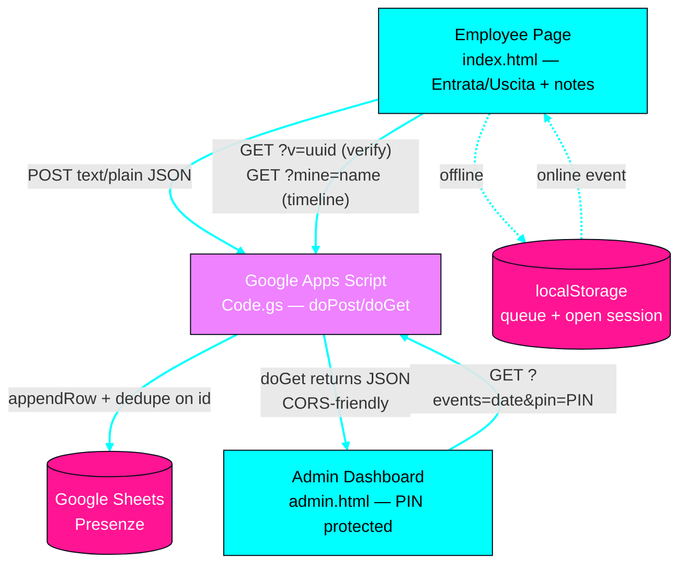

# Check-in Presenze — Erodo OY

Attendance system for workers with **two interfaces**:

| Interface | File | Who | What it does |
|---|---|---|---|
| **Lavoratore** | [`index.html`](index.html) | Employee | **Entrata / Uscita** toggle, optional **notes**, GPS, offline queue, "your day" timeline |
| **Admin** | [`admin.html`](admin.html) | You (owner) | PIN-protected dashboard: who's present now, sessions with worked hours, notes, GPS links, chronological event log |

Backend: Google Apps Script ([`apps-script/Code.gs`](apps-script/Code.gs)) writing to a Google Sheet.

## Employee interface

- **Entrata / Uscita** segmented toggle (auto-switches to *Uscita* when a session is open).
- **Open-session banner**: "In servizio da 2h 14m" with a live counter; session is persisted in `localStorage` (closing the browser doesn't lose it). Sessions open >16 h are flagged as forgotten.
- **Notes field** (optional, max 500 chars) — e.g. "consegna materiali", "cantiere X".
- **GPS** with retry, "continua senza GPS", and ±100 m accuracy warnings.
- **Offline queue** — events are queued in `localStorage` and flushed on reconnect.
- **Honest delivery states** — confirmed / sent-unconfirmed / queued (never fake success).
- **"La tua giornata di oggi"** timeline — the worker sees their own events + durations + notes.
- Receipt card with event type, duration (on check-out) and event ID.

## Admin interface

- **PIN login** — the PIN is a Script property (`ADMIN_PIN`), never shipped in the page code; session kept in `sessionStorage`.
- **Stats row**: present now · total entrances · total exits · worked hours · missing check-outs.
- **Sessions table**: per-worker entry, exit, duration, status (● still here / completed / ⚠ orphan exit), GPS link, notes.
- **Chronological event log**: time, type, name, GPS, notes.
- Date picker + manual refresh + **auto-refresh every 60 s**.
- `noindex, nofollow` meta so the admin page isn't indexed.

## Data model (one row per event)

```
id | session_id | event(IN/OUT) | timestamp_server | iso | timestamp_locale | tz
   | nome | lat | lon | accuracy | geo_skipped | notes | maps_url | device_id
```

- `IN` starts a session (`session_id = id`), `OUT` references the `IN` id.
- Dedupe on `id` (idempotency) server-side under a `LockService` lock.
- Server also records its own authoritative timestamp.

## Architecture



**Legend:** cyan = primary modules (the two interfaces) · violet = gateway (Apps Script) · pink = data layer (Sheet, local storage).

### Session lifecycle

```mermaid
flowchart LR
    N[No session] -->|"Entrata ✓"| O[(open session<br/>localStorage)]
    O -->|"Uscita ✓"| C[Closed — duration<br/>written to Sheet]
    O -->|">16h forgotten| F[Flagged, auto-closed<br/>⚠ warning toast]
    O -->|offline| Q[(queued)]
    Q -->|reconnected| O

    classDef Primary fill:#00ffff,color:#000,stroke:#080d1a
    classDef Gateway fill:#ee82ff,color:#fff,stroke:#080d1a
    classDef DataLayer fill:#ff1493,color:#fff,stroke:#080d1a
    class N,C,F Primary
    class Q Primary
    class O DataLayer
```

## Setup

### 1. Backend

1. Create a Google Sheet.
2. **Extensions → Apps Script**, paste [`apps-script/Code.gs`](apps-script/Code.gs).
3. **Project Settings → Script properties** → add `ADMIN_PIN = <your-PIN>` (this unlocks `admin.html`).
4. **Deploy → New deployment → Web app** — Execute as: *Me*, Access: *Anyone*.
5. Copy the `/exec` URL into `SCRIPT_URL` in **both** `index.html` and `admin.html`.

> ⚠️ The current `SCRIPT_URL` still points to the **old v1 deployment**. Redeploy with `Code.gs` v2 — otherwise entry/exit events and the admin dashboard won't work (the old script has no `?events=` / `?mine=` endpoints).

### 2. GitHub Pages

Already enabled: **https://zjoker10.github.io/jojolly-presenze/**

- Employee link → `/` (`index.html`)
- Admin link → `/admin.html` (also reachable via the "🛡 Admin" button)

## Security notes & limits

- The admin PIN travels as a query parameter over **HTTPS** to Apps Script — fine for a small team, but it is a **shared secret, not real auth**. Don't reuse an important password; rotate it via the Script property anytime.
- The worker timeline (`?mine=Name`) is public-by-URL; the sheet itself is only readable by the account owner.
- For stronger security, move the backend behind Google Identity or an Apps Script `doGet` token check.

## GDPR checklist

Built in: privacy notice on the worker page (data list, purpose, retention, rights, GPS opt-out via "Continua senza GPS").

Still on you before production:

- [ ] Document the **legal basis** (art. 6 GDPR) for tracking employee location.
- [ ] Set and enforce a **retention period** (e.g. delete rows older than 12 months via a daily trigger).
- [ ] Restrict **Sheet access** to only the people who need it.
- [ ] The device fingerprint is a truncated SHA-256 duplicate-guard — remove it if you don't need it.

## Local dev

```bash
python3 -m http.server 8000 -d .
# http://localhost:8000        → employee
# http://localhost:8000/admin  → admin
```

## File layout

```
jojolly-presenze/
├── index.html              # employee interface
├── admin.html              # admin dashboard (PIN)
├── apps-script/Code.gs     # backend v2 (IN/OUT, notes, admin API)
├── README.md
└── .gitignore
```
