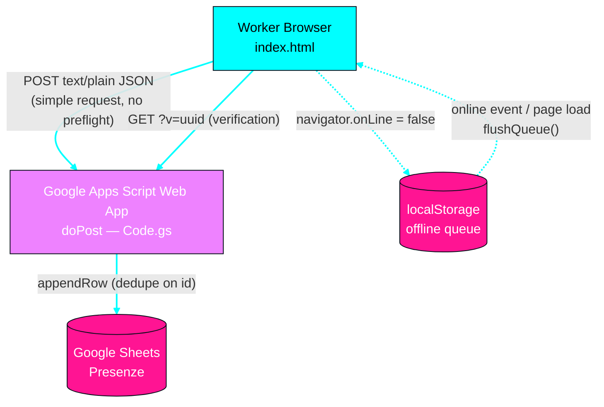
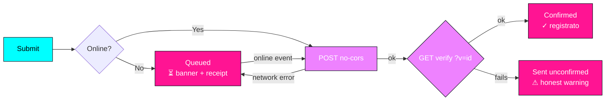

# Check-in Presenze — Erodo OY

Single-page attendance check-in app (Italian) that records a worker's **name**, **timestamp (ISO 8601 + local)**, and **GPS position**, then submits it to a Google Apps Script backend writing into Google Sheets.

Live demo: <https://jojolly26.github.io/checkin-presenze/>

## What changed vs. the original

The original was a good-looking but unreliable form. This version fixes correctness, reliability, accessibility and privacy:

| # | Problem in original | Fix |
|---|----------------|-----|
| 1 | `fetch(..., mode:'no-cors')` can never detect HTTP errors → showed "✓ registrato" even when nothing was saved | **Honest delivery states**: confirmed / sent-unconfirmed / queued. Server verification via `doGet(?v=<id>)` |
| 2 | `Content-Type: application/json` is stripped in `no-cors` mode → Apps Script `e.postData.json` could be empty | Sends `text/plain` (simple request, no preflight); server parses `e.postData.contents` |
| 3 | Timestamp was `toLocaleString()` only (device-local, ambiguous, no TZ) | Sends **`iso` (ISO 8601 UTC)** + local string + IANA timezone; server also records its own authoritative time |
| 4 | No duplicate protection | Client-generated **UUID idempotency key**; server dedupes on the `id` column (idempotent response) |
| 5 | GPS error was a dead end (submit disabled forever) | **"Riprova localizzazione"** button + **"Continua senza GPS"** escape hatch (`geoSkipped: yes` row) |
| 6 | Poor accuracy (±200 m) silently accepted | Warns when `accuracy > 100 m` |
| 7 | Offline worker lost the check-in | **Offline queue** in `localStorage`, auto-flushed on the `online` event |
| 8 | Success was just a toast + form reset | **Receipt card**: name, time, coords, status, and check-in ID |
| 9 | No `<label for>`, no `aria-live`, tiny low-contrast text | Proper labels, `aria-live` regions, raised `--muted` contrast, 16px inputs (no iOS zoom), `prefers-reduced-motion` support |
| 10 | GDPR: silent employee location + device fingerprint | **Privacy notice** in the footer (legal basis, data list, retention, rights, opt-out via GPS skip) |
| 11 | No meta description / OG / favicon / theme-color | Added all |

## Architecture



**Legend:** cyan = primary module (the page) · magenta-pink = data layer (Sheets, local queue) · violet = gateway (Apps Script) · gray = external.

### Delivery states



## Backend setup

1. Create a Google Sheet.
2. **Extensions → Apps Script**, paste [`apps-script/Code.gs`](apps-script/Code.gs).
3. **Deploy → New deployment → Web app**
   - Execute as: **Me**
   - Who has access: **Anyone**
4. Copy the `/exec` URL into `SCRIPT_URL` in `index.html`.

The backend provides:
- `doPost` — validates, **dedupes on `id`**, appends a row (server timestamp included).
- `doGet(?v=<id>)` — returns `{ok:true}` when the check-in exists (used for real delivery confirmation).

> ⚠️ The current `SCRIPT_URL` points at the **old** deployment. Until you redeploy with `Code.gs`, verification will fall back to *"inviato, non confermato"* — which is the honest behavior (the old script has no `doGet`).

## Local development

```bash
# any static server works
python3 -m http.server 8000 -d .
# open http://localhost:8000
```

Deploy to GitHub Pages: push to `main`, enable Pages (Settings → Pages → Deploy from branch → `main` / root).

## Privacy / GDPR

Employee location + name is personal data under **Reg. UE 2016/679**. The page ships a built-in notice (footer `<details>`). Before production use:

- Confirm the **legal basis** (art. 6 — likely contract/legal obligation or legitimate interest) and document it.
- Set a **retention period** for the sheet rows and delete expired data.
- The device fingerprint is a truncated SHA-256 used only as a **duplicate-send guard**; it is not a tracking ID. Remove it entirely if not needed.
- GPS is **optional** — workers can submit without it.

## File layout

```
jojolly-presenze/
├── index.html              # the whole app (UI + logic, single file)
├── apps-script/Code.gs     # backend: doPost/doGet + dedupe + sheet writes
├── README.md
└── .github/workflows/      # (optional) CI placeholder
```
